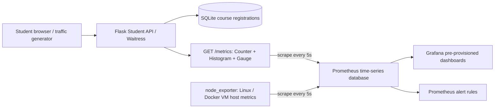

# PulseCampus — Group 39 DevOps Mini Project

**Project:** Flask Course Registration API Performance Monitoring with Prometheus and Grafana  
**Experiment:** Monitor application and system performance using Prometheus, and visualize metrics in Grafana dashboards.  
**Class:** Third Year Computer Engineering · Group **39**

## Group members

| Student | Roll number |
|---|---|
| Shlok Kurup | 124A1070 |
| Hemakshi Monga | 124A1084 |
| Krish Karthick | 124A1067 |
| Mayzabeen Labbai | 124A1071 |

## What you get

- Working **Flask Course Registration / Student API**, SQLite database, and responsive student-management browser UI.
- **Prometheus Python client:** request `Counter`, response-time `Histogram`, active-student `Gauge`, and in-flight-request `Gauge`.
- Exposed raw `/metrics` endpoint, health check, and **Prometheus 5-second scrapes**.
- Auto-configured **Grafana dashboard** with **20 panels**, including the four mandatory metrics: requests/sec, average latency, **p95**, and **5xx error rate**.
- System and application metrics: Linux / Docker VM CPU and memory from `node_exporter`, plus Flask process CPU and memory.
- Intentional slow and 503 demo endpoints, and a concurrent, configurable **Python traffic generator** (normal / slow / errors / mixed / sessions).
- Optional Prometheus alerting rules for availability, elevated 5xx rate, and high p95 latency.
- Automated unit tests, an automated stack smoke-check, Windows helper scripts, and detailed demonstration/viva documentation.

> **Scope:** Educational demo, designed for a single app process on a local laptop. The session endpoints model active users; they are *not* secure login/authentication. Docker Desktop monitors its **Linux VM** with `node_exporter`, not native Windows hardware metrics.

## Requirements

- Windows 10/11, Linux, or macOS
- **Docker Desktop** (Windows/macOS) or Docker Engine + Compose V2 (Linux), with enough memory to run 4 containers. **Start Docker Desktop before running commands.**
- Python 3.10+ on your computer for running the demo traffic script (the Flask container uses Python 3.12).
- Internet access the **first time** to download Docker images and pip libraries.

## Start the complete project — easiest way

1. Extract the ZIP (do not run it from inside the archive).
2. Start Docker Desktop and verify it reports *Engine running*.
3. Open a terminal **in the extracted project's root directory**.
4. Run:

   ```bash
   docker compose up --build -d
   docker compose ps
   ```

   On Windows, you can also double-click `start_windows.bat`.

5. Open these URLs (all on **your own computer**):

   | Page | URL | What to see |
   |---|---|---|
   | Flask UI | http://localhost:5000 | Student registration, enrollments, demo lab |
   | Flask raw metrics | http://localhost:5000/metrics | Text starting with `# HELP`, including request metrics after traffic |
   | Prometheus targets | http://localhost:9090/targets | `course-api`, `prometheus`, and `node-exporter` targets **UP** |
   | Grafana login | http://localhost:3000 | Use `admin` / `group39demo` initially |
   | Grafana dashboard | http://localhost:3000/d/group39-course-api | Auto-provisioned dashboard in the **Group 39** folder |

   Change Grafana demo credentials in `.env` (copy from `.env.example`) if needed. The defaults are for a classroom laptop **only**, and all published ports bind to 127.0.0.1.

6. Grafana may show **No data** initially because no API requests have been generated. That's expected! Register a student and enroll in a course, or start the traffic generator.

## Run a live traffic demo

From the same project directory, using Windows Terminal / PowerShell / CMD:

```bash
python scripts/generate_traffic.py --mode normal --duration 90 --rps 10
python scripts/generate_traffic.py --mode slow --duration 90 --rps 8
python scripts/generate_traffic.py --mode errors --duration 90 --rps 10
python scripts/generate_traffic.py --mode mixed --duration 90 --rps 12
python scripts/generate_traffic.py --mode sessions --duration 30 --rps 1
```

Run the commands **one at a time**. The script uses only the Python standard library. For Windows, `run_traffic_windows.bat mixed` runs a 90-second mixed demo.

- Normal → throughput / request counter rises.
- Slow → latency / p95 rises (intentional ~1.4 s requests).
- Errors → **503** response counts and 5xx error % rise.
- Sessions → a new student plus session per iteration, pushing **active_users** up. Sessions automatically expire after 15 minutes or can be ended from the UI.
- Mixed → these effects can appear together.

**Important:** Prometheus scrapes every 5 seconds. `rate(...[1m])` normally needs at least 2 samples; p95 uses a `[5m]` window. Wait for a few scrapes after starting traffic and view **Last 15 minutes** in Grafana (auto-refresh 5 seconds).

## UI demonstration

1. On the Flask UI, register a student using a name and an email address.
2. Select the student and choose an available course, then click **Confirm enrollment**. The database and enrollment list update.
3. In **Traffic & failure simulation**, click **Normal request**, **Slow request**, and **Failing request** and view the results; `Failing request` intentionally produces HTTP 503.
4. Select a student, click **Start session**; see **Active users** increase. Click **End session** to decrease it.
5. Open the Grafana dashboard and show the corresponding graphs. Run the traffic generator for sustained traffic.

## Architecture



**Note:** The arrows to Prometheus represent a Prometheus **pull/scrape** initiated by Prometheus; `/metrics` does not push metrics to it. The project does not claim that Grafana or Flask uses WebSockets to provide real-time output.

## API routes

| Route | Method | Purpose |
|---|---|---|
| `/` | GET | Browser UI |
| `/health` | GET | Service and SQLite check |
| `/metrics` | GET | Prometheus text exposition |
| `/api/courses` | GET | All courses, capacity, and enrollment counts |
| `/api/students` | GET / POST | List or register students |
| `/api/enrollments` | GET / POST | List or create registrations |
| `/api/enrollments/<id>` | DELETE | Remove a registration |
| `/api/summary` | GET | Live database totals and active user count |
| `/api/sessions` | POST | Open a demo student session and increase active users |
| `/api/sessions/<token>` | DELETE | Close a demo session |
| `/api/demo/slow?delay_ms=1200` | GET | Intentional slow endpoint (max 3000 ms) |
| `/api/demo/error` | GET | Intentional HTTP 503 endpoint |

**Sample API call (PowerShell):**

```powershell
Invoke-RestMethod -Uri http://localhost:5000/api/students -Method Post -ContentType 'application/json' -Body '{"name":"Aditi Sharma","email":"aditi@example.com"}'
```

## PromQL — mandatory performance metrics

**Requests per second:**

```promql
sum(rate(http_requests_total{job="course-api"}[1m]))
```

**Average response latency (ms):**

```promql
1000 * sum(rate(http_request_duration_seconds_sum{job="course-api"}[1m]))
 / clamp_min(sum(rate(http_request_duration_seconds_count{job="course-api"}[1m])), 0.001)
```

**95th percentile latency (ms):**

```promql
1000 * histogram_quantile(0.95,
 sum by (le) (rate(http_request_duration_seconds_bucket{job="course-api"}[5m])))
```

**HTTP 5xx error percentage:**

```promql
100 * (sum(rate(http_requests_total{job="course-api",status=~"5.."}[1m])) or vector(0))
 / clamp_min(sum(rate(http_requests_total{job="course-api"}[1m])), 0.001)
```

**Current active students:** `active_users{job="course-api"}`

The Grafana file is pre-provisioned at `config/grafana/dashboards/group39-course-monitoring.json`. **Do not manually import** the same dashboard a second time unless you intentionally removed provisioning.

## Stop / restart / persistence

```bash
docker compose down             # Stop containers; preserve course database and metrics

docker compose up --build -d    # Restart stack

docker compose logs -f app      # Application logs

docker compose ps               # Container status
```

**DANGER:** `docker compose down -v` deletes the **named volumes** (student/enrollment records, Grafana data, and historical Prometheus samples). Only use this when you deliberately want a complete reset.

## Tests

```bash
# Optional local unit tests (install Python dependencies first):
python -m pip install -r requirements-dev.txt
python -m pytest -q

# With Compose stack running:
python scripts/verify_stack.py
```

Note that running the Flask test suite initializes a temporary SQLite database. No remote API keys, third-party cloud services, or paid accounts are required.

## Run Flask without Docker (optional, not the full monitoring project)

```bash
python -m venv .venv
# Windows: .venv\Scripts\activate
# macOS/Linux: source .venv/bin/activate
python -m pip install -r requirements.txt
python -m app.main
```

You can use the Student UI locally, but **Prometheus and Grafana dashboards will not run** until you start the Compose stack. For the complete teacher demonstration, use Docker Compose.

## Documentation included

| File | Purpose |
|---|---|
| `docs/REQUIREMENTS_MATRIX.md` | Every point from your assigned Excel row, mapped to an implementation |
| `docs/EXPERIMENT_WRITEUP.md` | Exact experiment wording, aim, prerequisites, procedure, output, conclusion |
| `docs/PROJECT_REPORT.md` | Ready-to-adapt project report content and system design |
| `docs/DEMO_GUIDE.md` | Step-by-step instructor demo and team member role division |
| `docs/VIVA_QUESTIONS.md` | Common oral-exam questions and answers |
| `docs/TROUBLESHOOTING.md` | What to do when Docker, Grafana, or metrics are not working |

## Limitations and responsible use

Local educational prototype, not a production service. There is no real authentication, authorization, encryption, session persistence, multitenant access, CI/CD infrastructure, or enterprise alert delivery. Protect data on your laptop and use sample student records rather than real private information. Grafana demo login is intentionally simple; change it before use outside localhost. CPU/memory host charts describe **Linux / Docker VM**, not necessarily the physical Windows machine.
